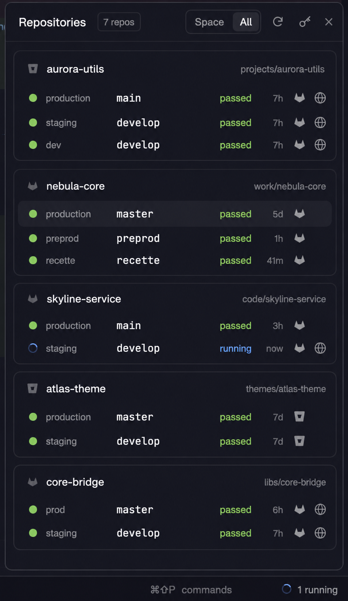

# Pipelines, a Herdr mod

A CI status button for the [Herdr](https://herdr.dev) app's status bar. It turns red with a count when a pipeline in the shown space fails, and opens a popup with one card for each GitLab, Bitbucket or GitHub repo open in your spaces. Each card has one row per deploy environment (production, preprod, recette…) showing the branch it deploys from and that branch's latest pipeline, then a row for the branch your space is on.



> [!WARNING]
> **This mod is entirely vibecoded.** An AI agent (Claude Code) wrote all of the code, the tests, the [RECIPE.md](RECIPE.md) and this README. I prompted it, tried the results in my own Herdr and asked for changes, but I haven't reviewed the code line by line. Read [What it runs and stores](#what-it-runs-and-stores) before giving it your tokens, and expect rough edges.

- **The button** shows "Pipelines", or a blue spinner and "2 running", or "1 failed" in red. It only counts the repos of the shown space.
- **One row per environment**, read from the CI itself: GitLab environments and their latest deployments, the `deployment:` steps in `bitbucket-pipelines.yml`, or GitHub deployments. Environments deploying the same branch share one row, and a repo without any shows its default branch.
- **Status at a glance**: a colored dot, or a spinning ring while the pipeline runs, the status, and how long ago it changed. The host icon opens the pipeline, the globe opens the environment's website, and the branch name opens the branch.
- **Space / All** switches the popup between the shown space's repos and every repo.
- **Toasts**, off by default: click the bell on a repo's card to be told when one of its pipelines you saw running ends ("production pipeline failed" or "staging pipeline passed").
- **Tokens view**: paste each host's token in the popup and it's saved in the mod's own `settings.json`, without editing any file.

## Install

Ask your agent to add this repo, or copy `mods/pipelines/` into `~/.config/herdr-app/mods/`. Leave out any `settings.json`, since that file holds tokens. Then run:

```sh
herdr-app check ~/.config/herdr-app/mods/pipelines
```

### The button in your layout

The mod docks nowhere by default. Wrap your layout's status-bar block in a row and add the button after it. Shipped layouts are read-only, so do this in your own clone (`layout.clone`):

```json
{ "id": "status-bar", "type": "row", "size": { "px": 28 }, "resizable": false, "children": [
    { "id": "status", "type": "block", "content": { "mod": "workspace-status" } },
    { "id": "pipelines-button", "type": "block", "size": { "px": 118 },
      "content": { "mod": "pipelines", "props": { "button": true } } } ] }
```

A block with no `props` draws the same panel docked, if you'd rather keep it in a side column.

### Keys

Merge [keys.json](keys.json) into yours, and check first that you don't already use these keys:

| Key | Command |
|---|---|
| `cmd-shift-i` | `pipelines.open`: open or close the popup |
| `cmd-shift-r` | `pipelines.refresh`: refresh now |

`pipelines.tokens` opens the popup on the Tokens view.

### Tokens

Press the key button in the popup, paste a token, then Save. Each host needs read access to pipelines:

- **GitLab**: a fine-grained token with Read on Pipeline, Environment and Deployment, or a legacy token with `read_api`. Self-hosted GitLab works too.
- **Bitbucket Cloud**: a repository or workspace access token with pipeline read, or an Atlassian API token with `read:pipeline:bitbucket` plus your email.
- **GitHub** (`github.com` only): a fine-grained token with Read on Actions and Deployments, or a classic one with `repo`.

If a host has no token saved, the mod falls back to `GITLAB_TOKEN` (for `GITLAB_HOST`, `gitlab.com` by default), `BITBUCKET_TOKEN`, `GH_TOKEN` / `GITHUB_TOKEN`, then `gh auth token`. Hosts without a token are hidden.

## What it runs and stores

- **Network**: it calls each repo's host API (GitLab, `api.bitbucket.org`, `api.github.com`) with that host's token. An environment-variable token only goes to the host it's meant for. It refreshes every 60s, and every 15s while a pipeline runs.
- **Programs**: `git remote get-url origin` in each space's folder (on the space's machine), `sh`, `gh auth token` when no GitHub token is set, and `open` for links (only `http(s)` URLs).
- **Files**: it reads `bitbucket-pipelines.yml` from your repos. Tokens are kept in `mods/pipelines/settings.json` (mode 600, git-ignored) and never in Herdr's shared state.

## Limits

- It only reads `origin`. GitHub Enterprise and Bitbucket Server aren't supported, and any host other than github.com or bitbucket.org is treated as GitLab over `https://`.
- The `bitbucket-pipelines.yml` reader isn't a full YAML parser: it follows `branches:` and anchors, but not glob keys or `!include`.
- A row has room for about 13 characters of branch name.

[RECIPE.md](RECIPE.md) has the full brief for building it from scratch, along with what tripped the build up.

## Development

```sh
npm test       # providers.js unit tests (node --test)
npm run check  # herdr-app check mods/pipelines
```

## License

[MIT](LICENSE).
