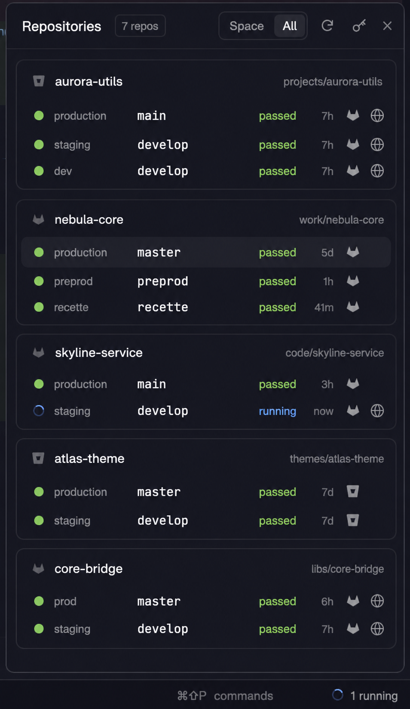

# Pipelines

A "Pipelines" button at the right end of the status bar, red with a count as soon as one of the shown space's pipelines has failed. Clicking it opens a popup with every GitLab, Bitbucket or GitHub repo open in your spaces, one card each, with one row per deploy environment its CI declares (production, preprod, recette…), showing the branch that environment deploys from and that branch's latest pipeline, then the build of the branch your space is on. A dot says how each pipeline went, a spinning ring shows one still running, a small GitLab, Bitbucket or GitHub icon opens the pipeline, and a globe opens the environment's website when the CI config gives it a URL. A Space / All switch narrows the list to the shown space, and a key button opens a Tokens view where you paste each host's token, without touching a file.



## What you see

- **The button**, a 118px block at the right end of the 28px status bar, after the shipped status bar's "⌘⇧P commands". It is drawn like the status bar: `chrome` background, a 1px `border` line on top, 11.8px text, 12px side padding, content right-aligned, 6px between icon and text.
  - Nothing failed: a 13px full-color green warp pipe (`pipe.svg` drawn with `image()`: a wide rim over a narrower body, dark green outline, light and dark side stripes) and "Pipelines", in `muted`, `foreground` on hover.
  - Something running and nothing failed: a 12px ring spinner in `ansi4` and "2 running".
  - Something failed: the one-color pipe (`pipeline.svg`, same shape, tinted with `svg()`) and "1 failed", both in `ansi1`.
  - It counts only the repos of the shown space, whatever the Space / All switch says, and follows you as you switch spaces.
- **The popup**, 380px wide, opened above the button with its right edge 6px in from the button's and its bottom 6px above it. It is 520px tall (`POPUP_HEIGHT`) whatever the view or the Space / All switch shows, since an open popup can't be resized: the list and the Tokens view scroll. Herdr draws its frame; the content has `theme().background` and Herdr's UI font at 13px.
  - **Header**, 42px, 14px left and 8px right padding, a 1px `border` line below: "Pipelines" (semibold); a chip with the repo count ("7 repos": 10px `muted` text, 1px `border`, 4px radius, padding 5×1); then, on the right, the Space / All switch, a 24×24 refresh button, a 24×24 key button (Tokens) and a 24×24 close button (✕).
    - The switch is two 20px-tall chips inside a 1px-bordered 6px-radius box with 2px padding: "Space" and "All", 11px. The selected one has the `selected` background and `foreground` text; the other is `muted`, `foreground` on hover.
    - Refresh shows a 14px circular arrow, or a 13px ring spinner while any copy is refreshing. Both header buttons are `muted`, with a `hover` background and `foreground` icon on hover.
  - **List**: one card per repo whose host has a token, 8px apart. The scroll area runs from the header line to the popup's bottom edge, with 12px top and bottom padding, 8px left and 14px right (the scrollbar's own gutter). A 12px fade lies over its top and bottom edges, from `background` to transparent, leaving the scrollbar's 14px uncovered. A card scrolled under an edge dissolves into it instead of meeting a border; at rest the fades only cover the padding. The Tokens view scrolls the same way.
  - **Card**: `surface`, 1px border (`accent` for the shown space's repo, which comes first; `border` otherwise; others follow space order), 9px radius, 4px padding.
    - **Head**, 30px: a 12px GitLab tanuki, Bitbucket bucket or GitHub octocat in `dim`, the repo name (semibold, truncated), the group path on the right (`choosik/js`, 11px, `dim`, at most 140px), then a 22×22 bell button: `bell-off.svg` in `dim` while the repo's toasts are off (the default), `bell.svg` in `foreground` once on; `raised` background and `foreground` on hover, with a tooltip. Head padding is 10px left, 4px right, so the bell lines up with the rows' icon slots.
    - **Rows**, 30px each, 10px left and 4px right padding, 6px gaps, 7px radius, `hover` background:
      1. a 14px slot with an 8px status dot, or a 12px spinning ring while the pipeline runs;
      2. the environment's name as the CI spells it ("production", "staging", "recette"), 72px, 11px, `muted`, truncated; "branch" in `dim` on a build row;
      3. the branch, terminal font (`settings().font_family`, else JetBrains Mono), 12px, truncated, underlined on hover;
      4. the status word, 11px, in the dot's color;
      5. how long ago the pipeline last changed, compact ("now", "12m", "3h", "2d"), 26px, right-aligned, 11px, `dim`; empty with no pipeline;
      6. two 22×22 icon slots, 2px apart, each with a 13px glyph in `muted` (`raised` background and `foreground` glyph on hover): the host's icon (tanuki or bucket) when the branch has a pipeline, then a globe when the environment has a URL. A missing icon leaves its slot empty, so the columns line up.
    - Rows: the repo's deploy environments, at most 6, by tier (production, staging, testing, development, other) then name. One row per branch: when several environments deploy the same branch (julbo's `staging` and `dev` on `develop`), only the first by tier shows. A repo whose CI declares none shows one "default" row on its default branch; no branch name is hard-coded. Then one "branch" row per distinct branch the repo's spaces are on (`spaces()[i].branch`), with that branch's latest pipeline (its build), unless an environment row already shows that branch.
  - Hosts without a token don't show: their repos are left out of the list, the repo count and the button. When no repo in view has a token, the list shows "Add a GitLab, Bitbucket or GitHub token to see your pipelines." in `dim`, with an "Add token" button below it (28px tall, 12px padding, 7px radius, `solid` background, `solid_foreground` text).
  - **Tokens view**, which replaces the list when the key button is on (`selected` background) or "Add token" is pressed. It lists every host, including those hidden from the list. The header says "Tokens" and keeps only the key and close buttons.
    - A `dim` 11px line: "Saved in the mod's settings.json, readable by you only. A saved token is never shown again."
    - One card per host found in your spaces, plus hosts that have a saved token: `surface`, 1px border, 9px radius, 12px padding, 8px gaps.
      - Head: the host icon, the host (12px semibold), and a state in 11px: "Saved" `ansi2` (with a `dim` "Remove" link, `ansi1` on hover), "From GITLAB_TOKEN" (only on the `GITLAB_HOST` card) / "From BITBUCKET_TOKEN" / "From GITHUB_TOKEN" / "From gh auth" in `muted`, or "No token" in `ansi3`.
      - The token to make, 11px `muted`.
      - A masked token input: 32px tall, 10px padding, 8px radius, 1px `input` border, `background`. Its placeholder is "glpat-…" or "Access token, or API token", and "Saved: type a new one to replace it" once a token is saved.
      - Bitbucket cards add an unmasked "Email, only with an Atlassian API token" input.
    - A footer right-aligned: "Cancel" (`raised`) and "Save" (`solid`, "Saving…" while it writes). An error from saving shows above it in 11px `ansi1`.
  - **A card's error** replaces its rows with one 11px `ansi1` line: "The token was refused (401)", "The token can't read pipelines here: give it Pipeline: Read on this project" (a GitLab 403), "The token can't read actions here: give it Actions: Read on this repo" (a GitHub 403), "<host> rate limit reached, retrying later" (a 429, or a 403 whose body mentions the rate limit), "No access to this repo (403|404)", "<host> answered <status>", "Cannot reach <host>".
  - **A card's warning**, one 11px `ansi3` line under its head, when a GitLab fine-grained token may read pipelines but not environments: "The token can't read environments here: give it Environment: Read on this project", or the same for deployments with Deployment: Read. The rows below are then the "default" fallback and the spaces' branches. A GitHub token without Deployments: Read gets the same warning ("The token can't read deployments here: give it Deployments: Read on this repo").
  - A broken config file shows a `ansi1` line under the header with the path and the JSON error.
  - Empty states, in `dim`: "Looking for repos…" before the first refresh, "No CI repo in this space" with Space, "No GitLab, Bitbucket or GitHub repo in your spaces" with All.
- **Status colors** (theme ANSI colors): `success` → `ansi2` "passed"; `failed` → `ansi1` "failed"; `running` → `ansi4` "running" with the ring; `manual` → `ansi5`; `pending`, `created`, `preparing`, `waiting_for_resource`, `scheduled` → `ansi3` with the word (underscores as spaces); `canceled`, `skipped` → `dim`; no pipeline → `dim` "no pipeline". Bitbucket states map onto these: COMPLETED + SUCCESSFUL → success, FAILED or ERROR → failed, STOPPED or EXPIRED → canceled; IN_PROGRESS → running, or manual when its stage is PAUSED or HALTED; PENDING or PARSING → pending. GitHub runs too: `in_progress` → running, `waiting` → manual, `queued` / `requested` / `pending` → pending; once `completed`, `success` or `neutral` → success, `failure`, `timed_out` or `startup_failure` → failed, `cancelled` or `stale` → canceled, `action_required` → manual, `skipped` → skipped.
- **Docked panel**: without `props.button` or `props.popup`, the mod draws the same panel as a block (10px radius, 1px `border` all round, no close button), for anyone who'd rather keep it in a side column.

## How it behaves

- Agent statuses (working, blocked, done, idle) aren't shown: the button and popup are about CI.
- **The button**: a press opens the popup above it, or closes it if it's open. `cmd-shift-i` from the bundled `keys.json` does the same, above the button once the button has been hovered or pressed once (before that, in the window's bottom-right corner, above a 28px status bar).
- **Closing**: the ✕, Esc, a click outside the popup, or the button or key again.
- **Tokens**: the key button or "Add token" opens the Tokens view (a card per host with a repo in your spaces or a saved token, plus always `github.com` and `bitbucket.org`), with the keyboard in the first host without a token. Typing a token and pressing Save, or Enter in any field, writes every filled field into `settings.json` and goes back to the list, which refreshes within a few seconds (the mod reloads, then refreshes). Empty fields leave their saved token as it is. With an email, a Bitbucket token is saved as `{ "email", "token" }` (Basic auth), and without one as a plain access token (Bearer). "Remove" deletes that host's token. Cancel or the key button goes back without saving. `pipelines.tokens` opens the popup straight on this view.
- **Space / All**: Space keeps only the repos of the shown space and follows the space as you switch. All shows every repo. The choice is shared and kept across restarts. It changes the popup only: the button always counts the shown space.
- **Which repos**: for every space, its folder is the live `cwd` of the first terminal pane in its tabs, else `space.folder`. `git remote get-url origin` runs there (on the space's machine). `bitbucket.org` remotes are Bitbucket, `github.com` ones GitHub; codeberg.org is skipped; every other host is treated as GitLab. Spaces on the same repo share one card.
- **Environments**, read from the CI:
  - GitLab: every available environment except review apps (names with a `/`, like `review/fix-login`), each with the branch (`ref`) of its latest successful deployment. Environments never deployed are left out. The tier is `environment:deployment_tier` in `.gitlab-ci.yml`, else GitLab's guess from the name. An old environment left beside its replacement, same tier and same branch (`prod` and `production` both on `master`), shows once: the one deployed last.
  - Bitbucket: `bitbucket-pipelines.yml` at the repo root. Under `pipelines: branches:`, every `deployment: <env>` in a branch's steps, directly or through a YAML anchor (`- step: *deploy-prod`), gives that env on that branch. One branch can deploy several (staging then production on `master`): the row shows the higher tier. The first branch found for an env wins. Glob keys (`release/*`, `{a,b}`) are skipped. The tier is guessed from the name: `pre-prod`, `preprod`, `stag`, `recette`, `uat`, `qa` → staging; `prod` → production; `test` → testing; `dev` → development; else other.
  - None found: one "default" row on the repo's default branch, read from the clone's `origin/HEAD` (`git symbolic-ref refs/remotes/origin/HEAD`), else from the host (GitLab `default_branch`, which needs Project: Read on a fine-grained token; Bitbucket `mainbranch`; GitHub `default_branch`). Without either, only the spaces' branches show.
  - GitHub: the latest 100 deployments. Each environment keeps its newest deployment's `ref`, skipping transient environments (previews) and deployments of a bare commit SHA. The tier is `production` for a production environment, else guessed from the name as for Bitbucket.
- **Website**: the globe opens a GitLab environment's `external_url` (its `environment:url`), or the `environment_url` of a GitHub deployment's latest status. Bitbucket environments have no URL, so Bitbucket rows have no globe.
- **Refreshing**: when the spaces, their `folder` or branches change, every 60s, and every 15s while a shown pipeline is running or pending (on GitHub, while any workflow of the commit runs, even once another has failed). CI environments are looked up again at most every 5 minutes per repo. The refresh button and `cmd-shift-r` refresh now and look the environments up again, even while another copy is refreshing (it runs once more when done). Only one copy refreshes at a time, and the others show its result at once. A terminal that moves to another repo shows at the next 60s refresh: a `cd` alone triggers none.
- **Clicks** in the popup: the host icon opens the pipeline, the globe the website, the branch name that branch on GitLab (`/-/tree/<branch>`), Bitbucket (`/branch/<branch>`) or GitHub (`/tree/<branch>`), and the card head the repo's pipelines page. The rest of a row only highlights.
- **Notifications**: off for every repo until its bell is clicked; the bell turns them on or off for that repo only, and the choice is kept across restarts. For a repo with them on, when a pipeline seen running or pending ends, a toast says "production pipeline failed" (`error`, stays until dismissed) or "staging pipeline passed" (`success`, 6s), with `group/repo · branch` as its body. On GitHub it waits for every workflow of the commit to end. Nothing is announced on first load.
- Nothing animates except the ring spinners (native `.spin(900)`).

## Built from

- `mods/pipelines/` with `mod.json` `{ "place": "none", "title": "Pipelines" }`: it docks nowhere by itself.
- **The layout change it needs.** Wrap the layout's status-bar block in a row and add the button block after it. The row keeps the old block's 28px and is not resizable:
  ```json
  { "id": "status-bar", "type": "row", "size": { "px": 28 }, "resizable": false, "children": [
      { "id": "status", "type": "block", "content": { "mod": "workspace-status" } },
      { "id": "pipelines-button", "type": "block", "size": { "px": 118 },
        "content": { "mod": "pipelines", "props": { "button": true } } } ] }
  ```
  Shipped layouts are read-only, so do this in a personal clone (`layout.clone`).
- **Roles**, picked from `props()` in `init`: `{ button: true }` draws the button; `{ popup: true, view }` is the popup the button opens (`openOverlay({ mod: "pipelines", kind: "popup", width: 380, height: 520, at, props: { popup: true, view } })`); no props draws the docked panel.
- **Shared state** (`shared` / `setShared`):
  - `pipelines.data`: the last result. Token values never go in it, only `saved` (hosts with a token in `settings.json`) and `env` (`{ <host>: "GITLAB_TOKEN" | "BITBUCKET_TOKEN" | "GITHUB_TOKEN" | "gh auth" }`: the hosts an environment token goes to). It is `{ key, at, refreshing, forced, saved, env, envCache: { <project id>: { at, envs } }, projects: [{ id, kind, host, path, web, spaces: [space ids], machine, root, error, rows: [{ role, ref, env, url, p: { id, status, web_url, updated_at } }] }], missing: [{ host, kind }], configError }`;
  - `pipelines.scope`: `"space"` or `"all"`;
  - `pipelines.notify`: the project ids (`<host>/<path>`) whose toasts are on, `[]` or missing by default;
  - `pipelines.popup`: the open popup's overlay id. The popup copy sets it in `init` and clears it in `close()` (also called on quit). The button only reads it to toggle;
  - `pipelines.button`: the newest button copy's id (see Watch out);
  - `pipelines.closed`: when a popup copy last closed (`Date.now()`), set in its `close()`;
  - `pipelines.anchor`: the button's distance from the window's bottom-right corner (`{ right, bottom }`), so it stays right when the window is resized or moved to another screen.
- **Files**: `main.js` (roles, refresh, drawing), `providers.js` (remote parsing, the GitLab, Bitbucket and GitHub APIs, the `bitbucket-pipelines.yml` reader, building the rows) and `placement.js` (where the popup opens, kept pure so it's tested). Icons, 24×24 and `currentColor`, drawn with `svg()` so they take the text color:
  - `spinner.svg`: a full circle at 0.24 stroke opacity plus a quarter arc, stroke 3.2;
  - `refresh.svg`: a circular arrow, stroke 2;
  - `close.svg`: an ✕, stroke 2;
  - `key.svg`: a key (a ring and a notched shaft), stroke 2;
  - `bell.svg`: a bell with its clapper, stroke 2; `bell-off.svg`: the same bell crossed by a diagonal, stroke 2;
  - `pipeline.svg`: three r 2.5 rings joined by short lines, stroke 2;
  - `globe.svg`: a circle, a meridian and the equator, stroke 2;
  - `gitlab.svg`: a filled tanuki;
  - `bitbucket.svg`: a filled bucket;
  - `github.svg`: a filled octocat mark.
- **`herdr` functions**: `spaces()`, `panes()`, `exec` (`git remote get-url origin` and `git rev-parse --show-toplevel` with `{cwd, on: space.machine}`; `sh -c` once to read `GITLAB_HOST`, `GITLAB_TOKEN` / `GITLAB_PRIVATE_TOKEN`, `BITBUCKET_TOKEN` and `GH_TOKEN` / `GITHUB_TOKEN`, then `gh auth token --hostname github.com` when neither is set; `open` / `xdg-open` / `rundll32 url.dll,FileProtocolHandler` by `window().platform` for `http(s)` URLs only), `readTextFile` and `writeTextFile` (the config, and `bitbucket-pipelines.yml` on the space's machine), `appHome()`, `theme()`, `settings()`, `window()`, `notify`, `openOverlay`, `closeOverlay`, `props()`, `shared`, `setShared`, `nextCommand()` (`refresh`, `open`, `tokens`). Inputs are `InputState` + `Input` from `gpui-base`, with `set_masked(true)` on token fields.
- **Network**, the global `fetch` with `Accept: application/json`:
  - GitLab, `https://<host>/api/v4/projects/<url-encoded path>` with `PRIVATE-TOKEN: <token>`:
    - `/environments?states=available&per_page=100` (`name`, `tier`, `external_url`);
    - per environment (the first 20 without a `/`), `/deployments?environment=<name>&status=success&order_by=id&sort=desc&per_page=1` (`ref`, `id`);
    - per row, `/pipelines?ref=<branch>&per_page=1` (`id`, `status`, `web_url`, `updated_at`).
  - Bitbucket, `https://api.bitbucket.org/2.0/repositories/<workspace>/<repo>/pipelines?target.branch=<branch>&sort=-created_on&pagelen=1` with `Authorization: Bearer <token>`, or `Basic base64(email:token)` when the token is `{ "email", "token" }`. It reads `uuid`, `build_number`, `state`, `created_on`, `completed_on`. The pipeline page is `https://bitbucket.org/<path>/pipelines/results/<build_number>`.
  - GitHub, `https://api.github.com/repos/<owner>/<repo>` with `Authorization: Bearer <token>`, `X-GitHub-Api-Version: 2022-11-28` and a `User-Agent` (GitHub refuses requests without one):
    - `/deployments?per_page=100` (`id`, `environment`, `ref`, `transient_environment`, `production_environment`);
    - per kept environment, `/deployments/<id>/statuses?per_page=1` (`environment_url`);
    - per branch, `/actions/runs?branch=<branch>&per_page=20`. A push starts one run per workflow, so the runs of the newest `head_sha` are combined: the status is the worst one (failed, running, manual, pending, canceled, success, skipped in that order), the link is that run's `html_url`, the age the latest `updated_at`, and the pipeline id is the SHA.
  - A repo's requests run in parallel, and the repos run in parallel too. Rows on the same branch share one pipeline request.
- **Config** `mods/pipelines/settings.json` in the Herdr home (`appHome()`), next to `main.js`. The Tokens view writes it, and it can also be edited by hand. Saving it reloads the mod, so changes apply at once. The folder ships `settings.example.json` and a `.gitignore` listing `settings.json`, and the real file is created with mode 600:
  ```json
  { "tokens": { "gitlab.example.com": "glpat-…",
                "bitbucket.org": { "email": "you@example.com", "token": "<Atlassian API token>" } } }
  ```
  - A GitLab token is a fine-grained personal access token (GitLab 18.10 or later, the Generate token menu's "Fine-grained token") with **Project** access and **Read** on **Pipeline**, **Environment** and **Deployment**, for all the projects to watch or the groups holding them. A legacy personal access token with `read_api` works too. Both go in the `PRIVATE-TOKEN` header. A Bitbucket one is a repository or workspace access token with the pipeline read scope, or `{ "email": "…", "token": "…" }` for an Atlassian API token with `read:pipeline:bitbucket`. A GitHub one is a fine-grained personal access token with **Read** on **Actions** and **Deployments** for the repos to watch, or a classic one with the `repo` scope.
  - The environment variables fill in for hosts missing from `tokens`, each for one host only: `GITLAB_TOKEN` for `GITLAB_HOST` (`gitlab.com` when unset, a scheme is dropped), `BITBUCKET_TOKEN` for `bitbucket.org`, `GH_TOKEN` or `GITHUB_TOKEN` for `github.com`, else the GitHub CLI's token. Every other host needs its own entry in `tokens`.
- **`keys.json`**: `{ "global": { "cmd-shift-i": "pipelines.open", "cmd-shift-r": "pipelines.refresh" } }`.

## Watch out

- **Security**: never send an environment token to a host it wasn't made for: remotes name any host, and every unknown one is treated as GitLab. Open only `http(s)` URLs, never through `cmd` (it runs what follows an `&`). The mod reaches the network (each repo's host, with the token), runs programs (`git`, `sh`, `gh auth token`, `open`). Without `GH_TOKEN` / `GITHUB_TOKEN`, it borrows the `gh` CLI's token, which often has wide scopes (`repo`, `workflow`): it goes to `api.github.com` only, and shares `gh`'s hourly budget and reads the repos' `bitbucket-pipelines.yml` outside its folder. Its tokens sit in its own `settings.json`: leave that file out when copying or publishing the folder.
- **Offline after sleep**: on wake the first refresh runs before the network is back. A request that can't reach its host (no HTTP status) keeps the card's last rows under a dim "Can't reach <host>, showing the last results" line and retries at the 15 s pace, never as a red error.
- **Rendering and popups**
  - Read the role from `props()`, not from `init`'s first argument: that argument didn't carry the layout's props in this build.
  - A popup sizes to its content, so a `size_full()` root collapses to its header. Set `.w(380).h(520)` on the popup's root, the size given to `openOverlay`. An open overlay can't be resized, so a height fitted to the content goes wrong as soon as the Space / All switch or the view changes it: keep it fixed.
  - The default pointer placement drops the popup off the bottom of the window. Open it with `at`, computed from the button's bounds: `on_click` events have no position, but `on_mouse_down` and `on_mouse_move` events carry `bounds`. A press places the popup from its own `bounds`; the key uses the saved anchor. Never save absolute bounds: the anchor persists, and once the window is bigger than when it was saved the popup lands toward the middle. Save the offset from the bottom-right corner (`globalThis.window.viewport_size()`, since herdr's `window` import shadows gpui's) and rebuild `at` from the live viewport, clamped 6px inside it (`placement.js`). If the viewport can't be read, open at the pointer rather than throw: the button's handlers call it on every press and hover. Write the anchor to shared state only when it changes, since every `setShared` redraws every mod.
- **Tokens view**
  - `InputState.new` needs a live host call, so the fields are made when the view opens (a click, or `init` for a popup opened on it), never in `render`.
  - Never read a saved token back into an input or into shared state: `shared.json` is plain and kept on disk.
  - Read, change and write `settings.json` with `writeTextFile(path, text, previousText)`, so an edit made meanwhile isn't overwritten. A file that isn't valid JSON is refused, not replaced.
  - `writeTextFile` replaces the file atomically, which loses its mode: run `chmod 600` after every write, and once on load.
  - Writing the file reloads the mod, which ends the task that wrote it. Before writing, set `at: 0` and clear `refreshing` in the shared data, and don't start a refresh after the write: the reloaded copies refresh at once on their own. A refresh started there takes the lease and dies with the reload, so every refresh waits a minute and the new token seems not to work.
  - A copy closed mid-refresh (a popup closed with Esc) clears `refreshing` in `close()`, so the others don't wait out the lease.
  - A forced refresh sets `forced` in the shared data rather than in the copy: the copy holding the lease runs once more when it ends, and the next refresh ignores `envCache`.
- **Edge fades**
  - Element backgrounds take only a color in this build (`Background.linear_gradient` is for canvas paths, and `.bg()` rejects it).
  - Build each fade from six 2px bands of `background` at alpha `f2`, `d9`, `b3`, `80`, `4d`, `1a` (reversed for the bottom), positioned absolutely.
  - Add the fades after the scroller so they draw over it.
- **Data and refresh**
  - After a hot reload, and every saved token reloads the mod, the old copy's `nextCommand()` loop still answers the next command, so `open` runs twice and cancels itself. Each button copy writes a fresh id to `pipelines.button` in `init`, and a copy whose id is no longer there leaves its loop without acting.
  - A press on the button while the popup is open first closes the popup as a click outside it, whose `close()` clears `pipelines.popup`, so the button would open it again. The button ignores a press that comes less than 300ms after `pipelines.closed` while no popup is open.
  - Don't reset `pipelines.popup` when the button starts: a popup open across a reload stays open, and the next press must close it. The popup owns that value.
  - Every copy runs the refresh timer, and the `refreshing` timestamp in the shared data is the lease. A lease older than 60s (a quit mid-refresh) is ignored.
  - `git remote get-url` runs once per space on every refresh, all spaces at once, and the spaces key also triggers one. Don't key it on anything that changes often (agent status, focus, a terminal's live cwd).
  - The environments cache lives in `pipelines.data`, so a new popup copy doesn't look them all up again.
  - The env tokens are read once per load. GUI-launched apps often lack `.zshrc` variables, so the config file is the dependable route.
  - A 401 on any pipeline request marks the whole card. Rows aren't fetched one by one for errors.
- **GitLab API**
  - A fine-grained token answers 403 for a permission it lacks. Name the permission in the message: a bare "No access" sends people looking at their project role. An Environment or Deployment 403 must not fall back silently to the "default" row, which looks like a repo without environments: show the warning. Failures aren't cached, so the warning returns on every refresh until the token is fixed.
  - Deployments can't be filtered by branch, and ordering by `updated_at` or `finished_at` needs extra filters (400 otherwise). Ask per environment, ordered by `id`.
  - An environment without a successful deployment has no branch to show, so it's left out.
  - Several environments can share a branch (julbo's `staging` and `dev` both on `develop`): they'd show the same pipeline twice, so only the first by tier keeps the row.
  - The API host is the remote's host on `https://`. A GitLab whose SSH and web hosts differ, or that serves over http or on a custom port, gets "Cannot reach" or a 404.
- **Bitbucket**
  - The `bitbucket-pipelines.yml` reader isn't a YAML parser: collect every `deployment:` in a branch block, anchors included, not just the first. It follows indentation under the first `branches:` and the anchors it can see. Multi-document files and `!include`s are not read.
  - Only Bitbucket Cloud (`bitbucket.org`) is supported. Bitbucket Server has no Pipelines.
- **GitHub**
  - Only `github.com` is supported: a GitHub Enterprise host is treated as GitLab.
  - The token budget is 5000 requests an hour. A repo costs one request per distinct branch each refresh (every 15s while one runs), so many busy repos at once can reach it: a 403 or 429 about the rate limit shows as its own error, not as missing access (on GitLab too).
  - Environments are whatever the workflows deploy to, including approval gates and release tags; there's no `environment:url` in the API, only the URL a deployment status reports.
- **Layout**
  - At 380px, with the 72px environment column, a row leaves about 13 characters of branch name. Keep the time compact and the icon slots fixed.
  - Only `origin` is read.
  - `cmd-shift-i` and `cmd-shift-r` are `ctrl` on Linux and Windows. Ask before replacing a key the person already uses.

## Done when

- `herdr-app check mods/pipelines` passes, and `npm test` (the `providers.js` tests in `test/`) passes.
- With the button block in the status bar, "Pipelines" shows after "⌘⇧P commands", in the status bar's colors.
- Without any token, the popup shows only "Add a GitLab, Bitbucket or GitHub token to see your pipelines." and an "Add token" button. With a GitLab token only, Bitbucket repos appear nowhere: not in the list, the count or the button.
- "Add token", the key button or `pipelines.tokens` opens the Tokens view with a masked field per host. Saving a token writes it to `settings.json` (mode 600), returns to the list and loads that host's cards. The host then shows "Saved", and "Remove" takes it away.
- With a GitLab token, each GitLab repo has a card with one row per environment showing its branch, status and age. The shown space's card has an accent border and comes first.
- A space on a feature branch adds a "branch" row with that branch's latest pipeline below the environments. A space on `develop`, when an environment deploys `develop`, adds none.
- A repo with `production`, `preprod` and `recette` environments shows exactly those three environment rows, each on the branch it deploys from, production first. An old `prod` environment beside `production` on the same branch doesn't add a row. A repo without environments shows one "default" row on its default branch. Environments sharing a branch show as one row.
- After saving a token in the Tokens view, that host's cards load within a few seconds.
- Rows whose environment has a URL have a globe that opens the site. Every row with a pipeline has the host icon, which opens the pipeline.
- A failed pipeline in the shown space turns the button red with "1 failed". A running one shows a blue spinner and "1 running", and is refreshed within 15s. A pipeline running in another space leaves the button at "Pipelines", even with All selected in the popup.
- A fine-grained GitLab token with Pipeline, Environment and Deployment read loads the same rows as a legacy `read_api` one. Without Environment: Read, the card shows the yellow warning above the "default" row.
- Pressing the button opens the popup above it. ✕, Esc, a click outside or the button again closes it, and `cmd-shift-i` toggles it.
- Space keeps only the shown space's repos and follows space switches. All brings the rest back, and the button counts the same rows.
- With a Bitbucket token, a `bitbucket.org` repo gets a card with a bucket icon, one row per `deployment:` env under `pipelines: branches:`.
- With a GitHub token (saved, `GITHUB_TOKEN`, or a logged-in `gh`), a `github.com` repo gets a card with an octocat icon, one row per deployment environment, and each row's status is the worst workflow run of that branch's latest commit.
